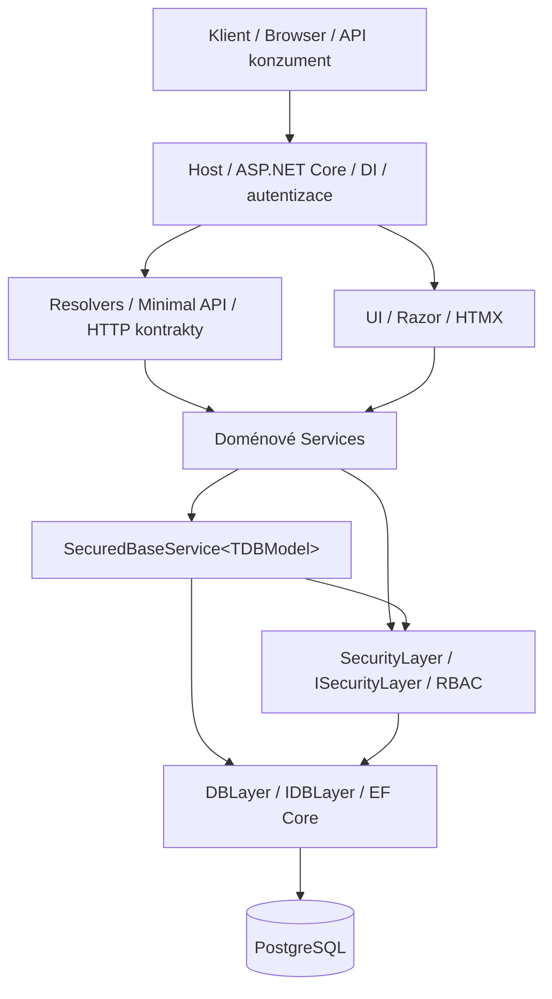
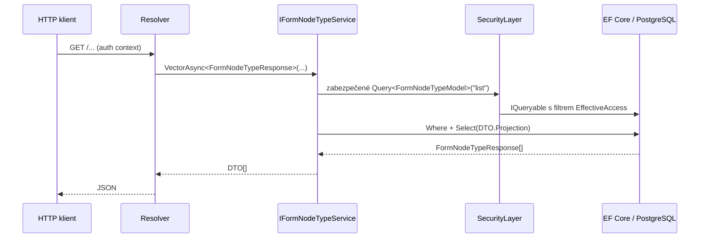

# ZArchitecture — architektura aplikací, vrstev, generik a bezpečnosti

**Referenční stav:** `ZArchitecture_114` (12. října 2026)  
**Účel:** architektonická dokumentace pro návrh, vývoj a rozšiřování systému.  
**Status:** popis implementovaného řešení doplněný o výslovně označená doporučení a otevřené otázky. Sestavení verze 114 nebylo v prostředí zpracování ověřeno.

## 1. Architektonická idea

ZArchitecture je modulární .NET aplikace, která odděluje **datový model, přístup k databázi, autorizační politiku, doménové operace, transportní API a uživatelské rozhraní**. Jejím cílem není vytvořit univerzální framework pro libovolnou aplikaci, ale poskytnout čitelný opakovatelný postup pro přidávání domén, u kterých jsou přístupová práva k jednotlivým záznamům běžným pravidlem.

Základní principy:

1. **Bezpečné výchozí chování:** běžná cesta ke čtení vede přes RBAC filtrované `IQueryable`; k nezabezpečeným DB operacím se dostane jen implementace důvěryhodné služby.
2. **Core nezná aplikace:** Core definuje obecné typy a infrastrukturu; DigitalProcesses závisí na Core, nikoli opačně.
3. **Model není DTO:** databázové entity se nepředávají přímo HTTP klientům; výstup se vybírá explicitně pomocí typované projekce.
4. **Generika šetří opakovaný kód, nikoli doménová pravidla:** čtení a základní aktualizační vzor jsou sdílené; vytváření, přechody stavů a další složité operace jsou explicitní.
5. **Jedna jednotka práce:** Core i přidaná doména používají v request scope stejný konkrétní EF Core kontext, change tracker a transakční prostředí.

## 2. Přehled vrstev



Šipky vyjadřují hlavní **závislosti za běhu a tok volání**, nikoli vždy doslovné projektové reference. `SecuredBaseService<TDBModel>` je implementována v `Core/SecurityLayer`, zatímco DTO a servisní kontrakty jsou definovány v `Core/Base`.

| Vrstva / projektová role | Co dělá | Co dělat nemá |
|---|---|---|
| **Host / Hosting** | Složí moduly, registruje DI, autentizaci, middlewares, endpointy | Obsahovat aplikační business logiku |
| **Models** | Definuje DB entity, vstupní a výstupní DTO a vztahy typů | Provádět HTTP operace nebo načítat data z DB |
| **DBLayer** | EF Core model, `IDBLayer`, query, staging změn, persistence | Rozhodovat podle HTTP payloadu o uživatelských právech |
| **SecurityLayer** | Identita aktéra, RBAC filtry, kontroly operací, bezpečné servisní základy | Obsahovat pravidla konkrétní aplikace, například workflow žádosti |
| **Services** | Doménové invarianty, validační scénáře, koordinace oprávnění a transakcí | Obcházet SecurityLayer „pro pohodlí“ |
| **Resolvers** | HTTP metody, parametry, validační hranice transportu, odpovědi, Swagger | Obsahovat vlastní alternativní autorizační mechanismus |
| **UI** | Razor, komponenty, HTMX, navigace a prezentace | Přímo pracovat s DbContext nebo důvěryhodně určovat aktéra |
| **Module** | Registrace služby, modelu aplikace a rout do Hostu | Vynucovat obrácenou závislost z Core na aplikaci |

### 2.1 Jak spolu vrstvy komunikují

Příklad **GET seznamu typů uzlů formuláře**:

1. Host ověří identitu a vytvoří request scope.
2. Minimal API resolver získá doménové `IFormNodeTypeService` z DI.
3. Resolver požádá o příslušné výstupní DTO, např. `VectorAsync<FormNodeTypeResponse>(...)`.
4. `SecuredBaseService<FormNodeTypeModel>` sestaví dotaz nad `FormNodeTypeModel` pomocí SecurityLayer.
5. SecurityLayer promítne účinná oprávnění aktéra do EF `IQueryable` **ještě před materializací**.
6. Na zabezpečený dotaz se aplikuje `FormNodeTypeResponse.Projection`.
7. EF Core přeloží filtr i projekci do SQL a dotaz se provede v PostgreSQL.
8. Resolver odešle DTO. Klient nedostává nekontrolovanou databázovou entitu.



**Odpovědnost rozhraní:** resolver vybírá HTTP kontrakt a DTO; doménová služba určuje *co* je operace; SecurityLayer určuje *zda* a *nad kterými záznamy* je dovolena; DBLayer provede dotaz.

## 3. Databázová vrstva a rozšiřování DbContext

Core obsahuje `CoreDbContext : DbContext` s obecnými tabulkami (`users`, `groups`, `group_types`, `roles`, `role_types`, `operations`, vazby a efektivní přístupy). DigitalProcesses definuje vlastní `DigitalProcessesDbContext : CoreDbContext` a doplňuje procesní, formulářové a workflow entity.

Zkrácený princip:

```csharp
public class CoreDbContext : DbContext
{
    public CoreDbContext(DbContextOptions options) : base(options) { }
    public DbSet<GroupModel> Groups => Set<GroupModel>();
    public DbSet<RoleModel> Roles => Set<RoleModel>();
    // Další Core entity.
}

public sealed class DigitalProcessesDbContext : CoreDbContext
{
    public DigitalProcessesDbContext(
        DbContextOptions<DigitalProcessesDbContext> options) : base(options) { }

    public DbSet<FormNodeTypeModel> FormNodeTypes => Set<FormNodeTypeModel>();

    protected override void OnModelCreating(ModelBuilder builder)
    {
        base.OnModelCreating(builder);
        builder.ConfigureDigitalProcesses();
    }
}
```

Skutečné registrační řešení v `DigitalProcessesModule.ConfigureServices`:

```csharp
services.RemoveAll<CoreDbContext>();
services.AddDbContext<DigitalProcessesDbContext>(
    options => options.UseNpgsql(connectionString));
services.AddScoped<CoreDbContext>(
    sp => sp.GetRequiredService<DigitalProcessesDbContext>());
```

Tím zůstává **jedna konkrétní instance kontextu v daném DI scope** i při volání Core služeb. `IDBLayer` zapouzdřuje přístup ke kontextu; specializovaná vrstva Services nestaví bezpečnost přímo na `DbSet<T>`.

**Důsledek pro migrace:** migrace musí být vytvářeny nad konkrétním aplikačním kontextem; více rozšiřujících kontextů nemá nezávisle měnit stejné Core tabulky bez jasně sjednocené strategie migrací. Pro nasazení DigitalProcesses je přirozeným migračním kontextem `DigitalProcessesDbContext`.

## 4. Bezpečnostní model

### 4.1 Základní objekty RBAC

Každá zabezpečená DB entita implementuje `ISecuredEntityDBModel` a má `rbacobject_id`, který odkazuje na bezpečnostní kontext. Uspořádání skupin tvoří strom, jehož cesta pomáhá vyhodnotit děděná práva.

Základní pojmy:

- **User:** uživatel, který operaci vykonává; efektivní identita přichází z důvěryhodného autentizačního kontextu.
- **Group / RBAC objekt:** místo, nad kterým se práva přidělují a dědí; může reprezentovat i zabezpečení záznamu.
- **Role:** přidělení uživateli nad konkrétní skupinou či bezpečnostním kontextem, případně s časovou platností.
- **RoleType:** pojmenovaný druh role, například správce nebo garant.
- **Operation:** konkrétní oprávnění (`read`, `list`, `create`, `update`, `delete` nebo doménová operace).
- **RoleTypeOperation:** normalizovaná vazba mezi typem role a operací.
- **EffectiveAccess:** dotazově využitelná projekce účinných rolí/oprávnění a jejich platnosti.

**Podstatný invariant:** `Membership` a `Role` jsou dvě odlišné věci. Členství ve skupině není předpokladem účinnosti role; jeho zánik nebo expirace nesmí automaticky rušit roli ani `EffectiveAccess`. Oprávnění se odvozuje z platných rolí a bezpečnostní hierarchie, nikoli ze samotného členství.

### 4.2 Vyhodnocení přístupu

Pro určitého aktéra, objekt a operaci se zjistí platná role či role zděděné z přípustných předků. Z typů rolí se odvodí povolené operace. Časové meze jsou součástí vyhodnocení. V implementaci `SecurityService.GetAllowedOperationsAsync` se operace získávají přes `EffectiveAccessModel`, `RoleTypeOperationModel` a `OperationModel`.

```text
Authenticated actor
  → effective role bindings for RBAC object / ancestors
  → role types
  → permitted operations
  → access decision / filtered IQueryable
```

Nepřítomná či neplatná identita znamená **fail-closed**. Uživatelské ID se nesmí přijímat jako autoritativní query parametr pouze proto, že je snadné jej předat do služby.

### 4.3 Zabezpečené čtení před projekcí

`ISecurityQueryProvider` vrací typované, bezpečnostně filtrované `IQueryable<TDBModel>`; adaptér `RbacSecurityQueryProvider` používá `ISecurityLayer.Query<TModel>(operation)`.

```csharp
protected IQueryable<TDBModel> SecuredModels(
    string operation = SecurityOperations.List)
    => _provider.Query<TDBModel>(operation);

public IQueryable<TDTO> Query<TDTO>()
    where TDTO : IEntityProjection<TDBModel, TDTO>
    => SecuredModels().Select(TDTO.Projection);
```

Pořadí **RBAC filtr → výběr povolených polí DTO → materializace** je architektonickou hranicí. Dotaz nad databázovým modelem je interní, ale `Query<TDTO>()` je veřejný typovaný kontrakt.

RBAC na řádcích **neznamená automaticky oprávnění ke všem polím nebo všem souvisejícím entitám**. DTO projekce musí být schválená pro danou operaci. Pokud projekce čte chráněnou cizí entitu, je třeba samostatně autorizovat i tuto relaci — například spojením dvou autorizovaných query. Pouhá EF navigace sama o sobě autorizaci vztahu nezaručuje.

### 4.4 Zápis a transakce

Zápis není „jen `db.Update()`“. Bezpečný postup:

1. Načíst cílovou entitu s oprávněním k dané operaci (typicky Update).
2. Ověřit invarianty a povolený rozsah změn.
3. V transakci aplikovat změny, persistovat a případně synchronizovat související bezpečnostní projekce.
4. Vrátit požadované výstupní DTO.

`SecuredBaseService` má k dispozici interní `Unsecured_*` operace pro důvěryhodné invarianty. Jde o **chráněný implementační mechanismus**, nikoli alternativní veřejné API. Jejich volání musí mít konkrétní bezpečnostní důvod a být auditovatelné v code review.

Při Create často neexistuje samotný chráněný záznam. Proto se kontroluje **oprávnění na rodičovském či katalogovém kontextu**, založí se entita a její RBAC objekt a teprve poté se aktualizuje projekce efektivních oprávnění. Vzor lze vidět u `FormNodeTypeService.CreateTypedAsync` a `CreateContainedAsync`.

## 5. Generika: kde jsou, co vynucují a proč zjednodušují kód

### 5.1 Generika na úrovni služby: pouze databázový model

```csharp
public abstract class SecuredBaseService<TDBModel> : IBaseService<TDBModel>
    where TDBModel : class, ISecuredEntityDBModel
```

Třída ví, **s jakou entitou pracuje**, nikoli **jaká konkrétní podoba výsledku musí být vždy vrácena**. Díky tomu jedna doménová služba může vracet různé bezpečné reprezentace téhož modelu: stručný seznam, detail nebo export, bez vytváření dalších základních služeb.

### 5.2 Generika na úrovni operace: schopnost a kompatibilita DTO

Definováno v `Core/Base/Data`:

```csharp
public interface IEntityProjection<TDBModel, TDTO> : IEntityDTOModel
    where TDBModel : IEntityDBModel
    where TDTO : IEntityProjection<TDBModel, TDTO>
{
    static abstract Expression<Func<TDBModel, TDTO>> Projection { get; }
}

public interface IEntityMapper<TDBModel, TDTO> : IEntityDTOModel
    where TDBModel : IEntityDBModel
    where TDTO : IEntityMapper<TDBModel, TDTO>
{
    static abstract TDTO FromModel(TDBModel model);
}

public interface ICreateDTOModel<TEntity>
    where TEntity : IEntityDBModel
{
    TEntity ToModel();
}

public interface IUpdateDTOModel<TEntity> : IEntityDTOModel
    where TEntity : IEntityDBModel
{
    TEntity ApplyTo(TEntity model);
}
```

**Proč existují dvě různé čtecí schopnosti?**

- `IEntityProjection<...>` poskytuje **expression tree**, který se může stát součástí SQL (`Select(TDTO.Projection)`). Nevyžaduje načtení celé entity.
- `IEntityMapper<...>` je obyčejné **mapování již materializovaného objektu**; hodí se pro návrat po Update nebo po složitější doménové operaci.

Jedno Response DTO smí implementovat obě rozhraní, ale **není k tomu nuceno**. Create a Update požadují jiné schopnosti a měly by je implementovat jen vstupní DTO určená pro danou operaci.

### 5.3 Reálné signatury servisní vrstvy

```csharp
public IQueryable<TDTO> Query<TDTO>()
    where TDTO : IEntityProjection<TDBModel, TDTO>;

public Task<TDTO?> GetByIdAsync<TDTO>(
    Guid id, CancellationToken ct = default)
    where TDTO : IEntityProjection<TDBModel, TDTO>;

public Task<TDTO> UpdateAsync<TRequest, TDTO>(
    TRequest request, CancellationToken ct = default)
    where TRequest : IUpdateDTOModel<TDBModel>
    where TDTO : IEntityMapper<TDBModel, TDTO>;

public Task DeleteAsync(Guid id, CancellationToken ct = default);
```

Příklad správného použití:

```csharp
IFormNodeTypeService service = /* DI */;

var list = await service.VectorAsync<FormNodeTypeResponse>(
    x => x.can_have_children);

var detail = await service.GetByIdAsync<FormNodeTypeResponse>(id);
```

Výstup `RoleResponse` zde **nemůže** být použit, pokud implementuje projekci pro `RoleModel`, a ne pro `FormNodeTypeModel`. Taková chyba se odhalí při kompilaci.

### 5.4 Co generika reálně ušetří

Bez generického základu by každý z 20+ servisů opakoval autorizované `GetById`, seznamy, stránkování, sestavování SQL projekce, běžnou kontrolu Update a práci s operacemi. S generickým základem se opakuje pouze doménový význam: *jak se entita vytváří, co se smí měnit, jaká pravidla kontrolovat a jaké další objekty vznikají či se aktualizují*.

Zkrácená služba:

```csharp
public sealed class FormNodeTypeService(
    ISecurityLayer security,
    ISecurityProjectionService projections,
    IDBLayer db)
    : SecuredBaseService<FormNodeTypeModel>(security, db),
      IFormNodeTypeService
{
    // Doménové metody: CreateTypedAsync, CreateContainedAsync, ...
}
```

Generický parametr `TDBModel` předává službě databázovou identitu, bezpečnostní kontrakt a typ dotazu. Parametr `TDTO` je zadán až tam, kde klient vybírá reprezentaci. Díky **statickým abstraktním členům rozhraní** implementace nepotřebuje runtime reflexi ani univerzální mapper pro běžné projekce.

### 5.5 Proč neexistuje univerzální `CreateAsync` pro všechno

Genericky uložit objekt není totéž jako **bezpečně jej vytvořit**. Například vytvoření typu uzlu formuláře musí kontrolovat oprávnění k nadřazené skupině, může vytvořit nový vlastní zabezpečovací objekt a vyžaduje synchronizaci RBAC projekce — vše ve správné transakci. Proto je veřejné Create často explicitní doménovou metodou.

`ICreateDTOModel<TEntity>` je **schopnost převést vstup na model**, nikoli automatické udělení oprávnění vstupnímu DTO zakládat libovolné zabezpečené entity.

## 6. Přidání nové domény se dvěma modely: katalog projektů

**Ukázková nová aplikace:** `Projects`. Obsahuje dvě databázové entity:

- `ProjectModel`: projekt s názvem, stavem a vlastníkem.
- `ProjectTaskModel`: úkol v projektu s textem, termínem a stavem.

Každá má vlastní `id` a `rbacobject_id`. Úkol patří do projektu přes `project_id`. Doména musí výslovně rozhodnout, zda úkol používá stejný RBAC kontext jako projekt, nebo svůj vlastní. Příklad níže volí **vlastní RBAC objekt úkolu**, jehož bezpečnostní skupina je podřízena skupině projektu. Jde o navrženou ukázku, nikoli existující třídy v archivu 114.

### 6.1 Struktura projektů

```text
src/Apps/Projects/
  Projects.Models/
    DatabaseModels/
      ProjectModel.cs
      ProjectTaskModel.cs
    DTO/
      ProjectResponse.cs
      ProjectTaskResponse.cs
      CreateProjectRequest.cs
      CreateProjectTaskRequest.cs
      UpdateProjectRequest.cs
  Projects.Services/
    IProjectService.cs
    ProjectService.cs
    IProjectTaskService.cs
    ProjectTaskService.cs
  Projects.Resolvers/
    ProjectEndpoints.cs
    ProjectTaskEndpoints.cs
  Projects.Module/
    ProjectsDbContext.cs
    ProjectsModule.cs
  Projects.UI/                   # volitelné
```

Pro malou doménu lze fyzické projekty později sloučit, ale odpovědnosti je vhodné zachovat.

### 6.2 Krok 1 — dva DB modely

Ilustrační skeleton (konkrétní auditní vlastnosti a rozhraní je nutné sladit s aktuálními konstruktory `ISecuredEntityDBModel`):

```csharp
public sealed class ProjectModel : ISecuredEntityDBModel
{
    public Guid id { get; set; }
    public Guid rbacobject_id { get; set; }
    public string name { get; set; } = "";
    // + společné auditní atributy dle kontraktu Core
}

public sealed class ProjectTaskModel : ISecuredEntityDBModel
{
    public Guid id { get; set; }
    public Guid rbacobject_id { get; set; }
    public Guid project_id { get; set; }
    public string title { get; set; } = "";
    // + společné auditní atributy dle kontraktu Core
}
```

### 6.3 Krok 2 — vlastní DTO projekce

```csharp
public sealed record ProjectResponse(Guid id, string name)
    : IEntityProjection<ProjectModel, ProjectResponse>
{
    public static Expression<Func<ProjectModel, ProjectResponse>> Projection
        => x => new ProjectResponse(x.id, x.name);
}

public sealed record ProjectTaskResponse(Guid id, Guid project_id, string title)
    : IEntityProjection<ProjectTaskModel, ProjectTaskResponse>
{
    public static Expression<Func<ProjectTaskModel, ProjectTaskResponse>> Projection
        => x => new ProjectTaskResponse(x.id, x.project_id, x.title);
}
```

**Poznámka k ukázce:** ve verzi 114 `IEntityProjection` dědí také `IEntityDTOModel`; úplná kompilovatelná DTO musí splnit i jeho konkrétní členy. Ukázka zde ilustruje vazbu `TDTO ↔ TDBModel` a SQL projekci, není zamýšlená k bezprostřednímu vložení bez doplnění společných DTO vlastností.

### 6.4 Krok 3 — dva doménové servisy

```csharp
public interface IProjectService : IBaseService<ProjectModel>
{
    Task<ProjectResponse> CreateProjectAsync(
        CreateProjectRequest request, CancellationToken ct = default);
}

public sealed class ProjectService(
    ISecurityLayer security,
    IDBLayer db)
    : SecuredBaseService<ProjectModel>(security, db), IProjectService
{
    public Task<ProjectResponse> CreateProjectAsync(
        CreateProjectRequest request, CancellationToken ct = default)
    {
        // (1) ověřit create scope
        // (2) sestavit ProjectModel a RBAC skupinu
        // (3) vytvořit oboje v transakci
        // (4) synchronizovat EffectiveAccess
        // (5) vrátit ProjectResponse
        throw new NotImplementedException();
    }
}

public interface IProjectTaskService : IBaseService<ProjectTaskModel>
{
    Task<ProjectTaskResponse> CreateTaskAsync(
        CreateProjectTaskRequest request, CancellationToken ct = default);
}
```

Právě zde se ukazuje přínos generik: **nepíšeme znovu bezpečné Get/List/Vector/Delete**, pouze skutečná doménová pravidla. Komentáře v Create nejsou implementací a `NotImplementedException` musí být nahrazeno transakčním kódem před použitím.

### 6.5 Krok 4 — zabezpečit vazbu ProjectTask → Project

Při vytváření úkolu nestačí ověřit `project_id` jako existující cizí klíč. Uživatel musí mít povolené zakládání podřízeného objektu v daném projektu. Služba ověří **Create na projektu nebo jeho explicitně určeném scope** a založí vlastní RBAC skupinu úkolu.

Při čtení detailu úkolu se nesmí bez kontroly připojit citlivé informace o projektu jen přes EF navigační vlastnost. Varianty:

- V DTO vracet pouze `project_id` (bezpečnější výchozí stav).
- Při potřebě detailů sestavit join **dvou nezávisle RBAC filtrovaných query** v jednom DbContext.
- Pro rozsáhlejší odpovědi provést dávkové obohacení již načtených povolených položek, ne N+1 jednotlivých dotazů.

### 6.6 Krok 5 — rozšířit DbContext

Pokud `Projects` poběží jako **samostatně nasazená aplikace**, stačí:

```csharp
public sealed class ProjectsDbContext : CoreDbContext
{
    public ProjectsDbContext(DbContextOptions<ProjectsDbContext> options)
        : base(options) { }

    public DbSet<ProjectModel> Projects => Set<ProjectModel>();
    public DbSet<ProjectTaskModel> ProjectTasks => Set<ProjectTaskModel>();

    protected override void OnModelCreating(ModelBuilder builder)
    {
        base.OnModelCreating(builder);
        builder.ConfigureProjects();
    }
}
```

**Důležitá varianta:** pokud má `Projects` běžet **současně s DigitalProcesses v jednom Hostu a jedné databázi**, nelze jen vedle sebe registrovat `ProjectsDbContext` a `DigitalProcessesDbContext`, každý přímo odvozený od `CoreDbContext`, a předpokládat jednu transakci. Je třeba vytvořit **jediný kompoziční DbContext** nasazení, který registruje Core i oba doménové modely (například `UniversityAppDbContext : CoreDbContext` s `ConfigureDigitalProcesses()` a `ConfigureProjects()`). Případně řešit oddělené kontexty a koordinaci transakcí explicitně. Pro tuto architekturu je vhodnější první možnost.

### 6.7 Krok 6 — DI a HTTP

Modul zaregistruje:

```csharp
services.AddScoped<IProjectService, ProjectService>();
services.AddScoped<IProjectTaskService, ProjectTaskService>();
```

Resolver pak mapuje požadavek na jednoznačnou servisní operaci, například:

```csharp
app.MapGet("/projects/{id:guid}", async (
    Guid id, IProjectService service, CancellationToken ct) =>
{
    var project = await service.GetByIdAsync<ProjectResponse>(id, ct);
    return project is null ? Results.NotFound() : Results.Ok(project);
});
```

Resolver **nepřidává vlastní filtr `user_id`**. Autorizované čtení je vlastností služby, nikoli konvencí, kterou každý endpoint musí znovu implementovat. V případě existujícího řešení je vhodné využít `BaseResolvers` a registraci rout z Core namísto ručního opakování.

### 6.8 Krok 7 — testy a kontroly bezpečnosti

Minimální testovací matice nové domény:

| Test | Očekávání |
|---|---|
| Uživatel nemá Read na projektu | `GetByIdAsync<ProjectResponse>` projekt nevrátí |
| Uživatel vidí jen část úkolů | `VectorAsync<ProjectTaskResponse>` vrátí jen povolené řádky |
| DTO pro ProjectModel použito nad ProjectTaskService | Compile-time chyba |
| Uživatel nemá Create na rodičovském scope | Vytvoření projektu / úkolu selže bez vedlejších zápisů |
| Uživatel nemá Update na úkolu | Aktualizace selže |
| Vytváření selže během zakládání RBAC skupiny | Transakce vrátí obě části zpět |
| Zánik Membership, Role zůstává platná | Práva vyplývající z Role se nezmění jen kvůli Membership |
| Projekce obsahuje související chráněný objekt | Samostatně se uplatní autorizační pravidla relace |
| Chybí důvěryhodná identita | Přístup je zamítnut (fail-closed) |

**Odhad množství nového kódu:** pro dva běžné CRUD modely je nutné vytvořit dva modely, několik DTO, dvě servisní rozhraní a implementace, konfiguraci EF, DI/endpoint mapování a testy. Není potřeba opisovat obecný CRUD a RBAC základ. Většina náročnosti se přirozeně přesune do *doménových invariantů* a *bezpečnostního kontextu Create*.

## 7. Co lze a co nelze bezpečně zobecnit

| Vhodné pro generický základ | Musí zůstat explicitní nebo přinejmenším kontrolované |
|---|---|
| RBAC filtrovaný SQL zdroj | Volba kontextu pro Create a dědění práv |
| Read / List / Vector / pagination | Workflow přechody a business invarianty |
| Projekce DB modelu do schváleného DTO | Čtení citlivých polí a chráněných relací |
| Jednotný vzor běžného Update | Přidělování rolí a synchronizace EffectiveAccess |
| Auditní a transakční infrastruktura | Speciální vedlejší efekty, externí systémy |
| Typová vazba DTO na DB model | Oprávnění měnit `rbacobject_id`, vlastníka nebo auditní údaje |

Zjednodušení tedy spočívá v **přesunu opakované infrastruktury do společných generik**. Nejde o odstranění rozdílů mezi doménami. Tím, že odlišnosti nejsou schované do obřího abstraktního CRUD frameworku, zůstává zdrojový kód pro běžného vývojáře čitelný.

## 8. Pravidla pro code review a udržitelnost

1. U každého nového endpointu je jasné, která doménová služba odpovídá za operaci.
2. Žádný veřejný resolver nezískává nezabezpečené `IQueryable<TDBModel>`.
3. DTO explicitně deklaruje pouze schopnosti, které skutečně poskytuje; read-only DTO není nuceno implementovat Create nebo Update.
4. Každý `IEntityProjection<TDBModel,TDTO>` představuje vědomě schválený seznam polí a pravidla souvisejících entit.
5. Update request nesmí umožnit měnit bezpečnostní a auditní pole bez explicitního doménového důvodu.
6. Create vždy jasně určuje rodičovský bezpečnostní scope a pravidla založení RBAC objektu.
7. Operace, které mění Role, RoleType nebo hierarchii skupin, udržují navazující efektivní oprávnění konzistentní.
8. Rozšiřující aplikace nevtahuje své typy a aplikační kontrakty zpět do Core.
9. Pro dané nasazení je explicitně vybrán jediný EF model / migrační kontext, má-li být zajištěna jedna transakce.
10. Aktualizace ZIP verzí se aplikuje do čistého adresáře: rozbalení přes starší verzi nemaže odstraněné `.cs` soubory.

## 9. Aktuální stav a oblasti vhodné k dalšímu zpřesnění

**Implementováno v referenčním stavu 114:**

- `SecuredBaseService<TDBModel>` bez DTO generického parametru na třídě.
- Samostatné `IEntityProjection`, `IEntityMapper`, `ICreateDTOModel` a `IUpdateDTOModel`.
- Typové constraints v `Query`, `GetById`, `Vector`, `Update`.
- RBAC SQL query provider s EffectiveAccess.
- Oddělené modely DigitalProcesses a odvozený `DigitalProcessesDbContext`.
- Specializované Create operace domény DigitalProcesses a jejich ochrana.

**Doporučené další kroky:**

- Doplnit kompilaci a integrační testy proti PostgreSQL jako povinnou CI bránu; současný dokument neposkytuje důkaz, že sestavení 114 prochází.
- Systematicky prověřit oprávnění projekcí nad souvisejícími entitami a skutečnou ochranu citlivých atributů.
- Zvážit ještě čistší read-only DTO kontrakt: současné `IEntityProjection` dědí negenerické `IEntityDTOModel`, takže musí splnit i jeho společné požadavky; to není totéž jako zcela bezpodmínečná projekce libovolného typu.
- Konzistentně řešit synchronizaci projekcí EffectiveAccess a transakční hranice ve všech doménách.
- Přidat automatizovaný *compile-only* test demonstrující, že nelze zaměnit DTO mezi dvěma DB modely.
- Ujasnit společný složený kontext pro Host kombinující více rozšiřujících domén.

## 10. Shrnutí architektonického rozhodnutí

**Doménová služba je generická vzhledem k databázovému modelu, ale nikoli vzhledem k jediné reprezentaci dat.** Každá metoda si vybírá požadovanou schopnost DTO pomocí statického typového omezení. Databázový přístup je oddělen od politiky RBAC, autorizace se aplikuje před projekcí a materializací, a složité Create či workflow operace zůstávají konkrétními doménovými metodami.

Přidání další domény se dvěma modely tedy typicky znamená **přidat modely, typovaná DTO, dva tenké servisy, EF konfigurace, endpointy a testy** — nikoli znovu programovat generické CRUD, filtrování podle uživatele či základní transakční infrastrukturu. To je hlavní zdroj přehlednosti, bezpečnosti a budoucí rozšiřitelnosti ZArchitecture.
